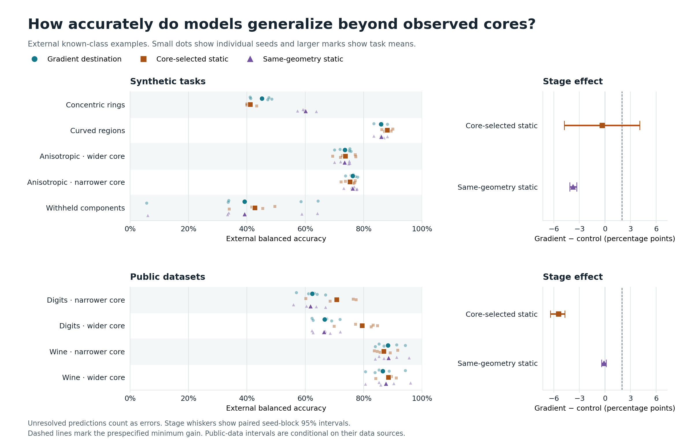

# Gravitational Decision Maps

## Bounded falsification study

**Research question.** Can class-attraction dynamics learned from labeled cores improve balanced accuracy on external examples of the same classes, under shared features and core-only fitting?

**Result.** The tested gradient dynamics fell short of the criterion for a useful extrapolation gain. They trailed the core-selected static champion by **0.35 percentage points on synthetic tasks** and **5.47 points on Digits and Wine**. Integrating the same fitted geometry reduced synthetic BA by 3.75 points, largely on the withheld ring wedges. On the public tasks it changed BA by −0.14 points. Anisotropic geometry improved the paired ablation in both stages. Stability construction repaired a convergence failure in one synthetic trial.

### Primary comparisons

| Frozen stage | Gradient BA | Core-selected static BA | Same-geometry static BA | Gradient − champion, pp (95% interval) | Gradient − same geometry, pp (95% interval) | Median latency ratio to champion |
| --- | ---: | ---: | ---: | ---: | ---: | ---: |
| Synthetic | 61.26% | 61.61% | 65.01% | −0.35 [−4.77, +4.07] | −3.75 [−4.15, −3.32] | 2.66× |
| Digits and Wine | 75.94% | 81.41% | 76.08% | −5.47 [−6.39, −4.69] | −0.14 [−0.41, +0.12] | 5.05× |

Both stages failed the accuracy criteria and passed the median latency cap. The synthetic champion interval still includes meaningful positive effects on this roster. The real champion comparison was negative in all five paired seed blocks. Stage D closes this pilot with a result about extrapolation bias and the behavior of the tested model family. A method superiority claim would require additional evidence beyond this study. [Synthetic evidence](results/synthetic/evidence.json) · [Real-data evidence](results/real/evidence.json)

| Task | Gradient BA | Core-selected static BA | Same-geometry static BA |
| --- | ---: | ---: | ---: |
| Rings, held-out wedge | 45.08% | 41.17% | 60.04% |
| Curved paths, held-out ends | 85.94% | 88.06% | 86.00% |
| Anisotropic mixture, wide core | 73.54% | 73.71% | 73.42% |
| Anisotropic mixture, narrow core | 76.17% | 75.29% | 76.17% |
| Disconnected regions, unseen components | 39.17% | 42.71% | 39.21% |
| Digits, narrow core | 62.39% | 70.75% | 61.75% |
| Digits, wide core | 66.60% | 79.51% | 66.45% |
| Wine, narrow core | 88.28% | 86.93% | 88.54% |
| Wine, wide core | 86.49% | 88.45% | 87.57% |

### What the ablations show

**H1 — gain over static methods.** The rings gain over the selected champion coexists with a 14.96-point loss to the same fitted geometry read at initialization. On Digits the gradient lost to the champion at both coverages. Wine's small positive narrow-core comparison reversed at the wider coverage. The parameter-near and compute-proxy MLPs trailed the gradient by 4.81 and 6.42 points on the synthetic aggregate. They led it by 6.96 and 6.59 points on the real aggregate. Their batch inference latency was below gradient latency in this run. [Synthetic method scores](results/synthetic/summary.json) · [Real method scores](results/real/summary.json)

**H2 — incremental value of integration.** With a fixed source-score readout, one step changed BA by −0.40 points on synthetic and −0.08 on real data. The 120-step readout reproduced the destination method's stage scores and lost 3.75 and 0.14 points to zero steps. On rings, middle-ring recall dropped from 87.2% to 31.1%. Of the 800 external middle-ring points, 449 went from a correct static label to the inner-ring class. Without rings the other synthetic groups' matched differences nearly cancel, a descriptive check of concentration. Inertial dynamics improved over the gradient by 1.91 points on synthetic data, driven by rings, and remained below the matched static control on that aggregate. On real data its BA was essentially unchanged from gradient.

**H3 — local geometry.** Using anisotropic instead of isotropic sources raised gradient BA by 6.48 points [5.42, 7.55] on synthetic data and 3.48 [1.44, 5.14] on the public aggregate. The public effect was positive at both Digits coverages and negative at both Wine coverages. The contrast of the learned field with the fixed-shape, equal-weight field was +7.78 points [4.19, 11.19] on synthetic data and −0.74 points [−2.78, +1.41] on public data. This contrast changes local shapes, scales and source weights together. Two prototypes helped the disconnected synthetic task and hurt both anisotropic variants. The paired worlds demonstrate how the same observed geometry and model can agree with one external rule and conflict with another. [Paired-world diagnostic](results/figures/paired_worlds.png)

**H4 — stability and sensitivity.** The stability patch raised synthetic strict BA by 0.74 points [0.00, 2.22], entirely in one rings split. There the relaxed field admitted five validated destinations versus six for the constrained one, and coverage rose from 72.92% to 100%. On the 11,070 synthetic primary examples resolved by both models, both assigned the same labels. The constrained and relaxed versions gave identical predictions on all 2,845 public external evaluations. Mean perturbation disagreement was 4.03% versus 4.07% on synthetic data and 0.55% for both on real data. Conditioning on two resolved predictions leaves 4.03% versus 3.97% on synthetic data. Median constrained-to-relaxed latency ratios were 1.34× and 1.92×. The measured tradeoff gives little evidence of a consistent improvement.

**Numerical and endpoint checks.** At the registered constrained destinations the local force is zero by construction and the smallest audited curvature over primary fits was 0.417 on synthetic and 0.237 on public data. The largest measured force norm at accepted relaxed roots was below $6.1\times10^{-8}$. Halving the gradient step at fixed horizon changed 62 of 11,200 synthetic primary labels, including 54 on rings. BA moved −0.29 points. On the public roster it changed zero labels. Halving the position and force tolerances changed no synthetic labels and changed one already incorrect public prediction to unresolved, leaving BA unchanged. The gradient first-entry variant matched destination BA in both stages at mean field evaluations per row of 8.53 versus 26.48 on synthetic, and 8.26 versus 31.22 on real tasks. These comparisons apply to the reported discretizations.

**Learned feature ablation.** The SA-nODE adaptation with a learned onset improved strict BA from 34.97% to 47.51% on synthetic tasks and from 59.60% to 70.06% on public tasks. Synthetic coverage rose from 71.89% to 96.77%, while nearest-anchor fallback BA stayed near 51%. On public data that fallback rose from 68.96% to 79.27%. The learned onset's zero-trajectory version gave 49.27% and 79.36% BA. This ablation changes encoder capacity and shows how finite-time resolution and learned features influence the comparison.

### Secondary outcomes and cost

| Stage | Gradient / champion external accuracy | Gradient / champion core-test BA | Gradient resolved coverage | Gradient / matched static median latency per row | Process peak RSS range |
| --- | ---: | ---: | ---: | ---: | ---: |
| Synthetic | 61.26% / 61.61% | 99.63% / 99.80% | 100.00% | 28.83 / 0.61 μs | 141–150 MiB |
| Digits and Wine | 74.89% / 80.34% | 97.17% / 98.19% | 99.98% | 73.40 / 1.28 μs | 147–158 MiB |

Score columns use the fixed group weights. Latency is the median across primary task-seed units. The gradient's median selected full fit took about 3 ms in each stage and its four validation trials about 46–47 ms. Six of 25 primary synthetic units and nine of 20 real units exceeded the 10× per-run ratio to the champion, despite both stage medians passing. Total primary workload time was 55 s for synthetic data and 72 s for real data, with environment setup separate. The latency plots and machine tables retain the capacity, MAC proxy, field evaluation, and coverage differences. The primary rosters contained synthetic distance strata of 1,634, 2,338 and 7,228 evaluations, and real strata of 415, 1,072 and 1,358. Accuracy, recall and class support for each stratum appear in the results. [Cost and accuracy](results/figures/cost_and_accuracy.png) · [Synthetic breakdown](results/synthetic/summary.json) · [Real breakdown](results/real/summary.json)

## Data and evaluation

The frozen protocol assigns five test seeds, 101, 113, 137, 151 and 181. Development uses 17 and 31 and separate simulated draws or real development entities. Benchmark cases cover withheld ring wedges, ends of curved paths, higher-dimensional anisotropic mixtures at two core radii, withheld whole components of disconnected classes, and two paired worlds with complementary external labels. All synthetic labels come from independent latent rules. The three imbalanced families change class frequency in training. Evaluation within those families samples balanced class counts.

The two public sources are UCI Optical Recognition of Handwritten Digits and UCI Wine. Digits uses the original 30-writer training and 13-writer test collections. Five disjoint row folds of the latter share the writer cohort. Wine uses a fixed stratified holdout of unique rows. Producer, vintage and writer identifiers at row level are unavailable. For both datasets the curator samples a limited classwise candidate set from the training source and admits observations within a declared radius of an admitted exemplar. Narrow and wide variants retain approximately 27% and 50% of candidates. Candidate counts, cutoff coordinates, tie rules and source hashes are recorded. [Benchmark sources and access terms](benchmark_data/README.md)

The study uses the identity representation on source columns with no pretraining. Candidate validation fits the scaler on the fitting portion of a stratified 75/25 split of admitted cores. Each selected model and its scaler are refitted on the admitted cores. Validation scores choose hyperparameters and the strongest core-validated static family for each run. The first declared trial or family wins ties. The curator uses labels to assign core and external membership. Model fitting receives only admitted training data. Core-test and external feature arrays are used after fitting, with per-row labels supplied for scoring. The code restricts information at the learner interface within a trusted local process. [Frozen protocol](protocol.json) · [Fit and prediction interface](gdm/experiment.py)

Primary external balanced accuracy (BA) is the mean recall over all known classes. Unresolved predictions count as errors. The per-run artifacts also include ordinary accuracy, core-test recall and BA, per-class support, resolved coverage, conditional scores, fallback BA and three distance strata. The strata use the median and 90th percentile of leave-one-out nearest-neighbor distances among scaled training cores. A stratum or core-test subset averages over the classes it contains. Perturbation changes compare each prediction with its prediction after a fixed-seed random direction of length 0.10 in scaled feature space. We report resolution flips and disagreement where both predictions resolve.

The synthetic aggregate gives equal weight to rings, curves, anisotropic mixtures and disconnected components, averaging the two anisotropic variants within their group. The complementary worlds are a separate identification check. The real aggregate gives equal weight to Digits and Wine, each averaged over its coverage variants. Differences are paired within task and seed. Intervals are 2.5% and 97.5% quantiles of 10,000 bootstraps of the five entire seed blocks. These are pilot intervals for the fixed task set. For real data they summarize seed sensitivity conditional on the source cohorts and split rules. Wine reuses a fixed holdout of 73 unique rows, and Digits reuses the test writer cohort across disjoint row folds. Results across the two coverage levels combine a change in permitted training rows and a change in external test membership. Reported ablation intervals are descriptive.

The prospective method criterion requires at least +2 percentage points against both the core-selected static champion and the paired static control in each stage. Each interval must have its lower endpoint above zero. The median per-run batch inference ratio against the static champion must be at most 10. Both stages are part of the locked test. Stage C checks portability without enlarging or retuning the method after Stage B. [Pre-execution protocol](protocol.json) · [EpistemeOS freeze](results/frozen.json)

## Field and readouts

For scaled input $z$, source $a_i$, positive precision $P_i$, bandwidth $b$ and mass $w_i$, the base potential is

$$
U_0(z)=-b^2\log\sum_i w_i
 \exp\!\left[-\frac{(z-a_i)^\top P_i(z-a_i)}{2b^2}\right].
$$

The class mass totals are uniform. Within a class, the fitted field mixes equal component weights and observed cluster proportions. One prototype uses a class mean. Multiple prototypes use within-core k-means and source points on observed support. Scales use core residuals with bounded relative variation. The anisotropic option uses shrunk local covariance shapes with bounded eigenvalues and a diagonal approximation above eight features. Candidate selection chooses prototype count, geometry and bandwidth by core validation. The fixed-shape control still places sources from core observations and uses a core-derived global scale. Its local precision is shared and isotropic and its within-class weights are equal. [Field implementation](gdm/dynamics.py)

For the constrained field, disjoint source neighborhoods use a quintic transition from $U_0$ to the quadratic $U_0(a_i)+\tfrac12(z-a_i)^\top P_i(z-a_i)$. The blend equals one within half the patch radius. Its first and second derivatives vanish at the join. This gives $F(a_i)=0$ and Hessian $P_i\succ0$ for positively separated sources. The gradient flow decreases the potential in exact time. The inertial flow starts with zero velocity and dissipates mechanical energy with damping 1.4. An energy strictly below the minimum patch-inner boundary energy certifies local trapping for that continuous inertial system. The relaxed version accepts associated shifted minima only after numerical residual, ownership and curvature checks. Additional equilibria and numerical ambiguity remain possible. [Field and equilibrium checks](gdm/dynamics.py)

Gradient flow uses Euler with step 0.2 and horizon 24. The damped inertial update treats the linear drag implicitly and uses the new velocity for the position update. Destination classification checks distance, force and dwell of 0.4 time units at a named equilibrium. The inertial check also uses speed and the local trapping condition. Local position and force tolerances are respectively 0.06 and 0.08 times the training radial scale. Position tolerance also has a neighborhood cap. An unresolved endpoint is scored as an error, with the initial static label recorded separately as fallback. First-entry classification instead labels the first disjoint core ball hit along a numerical segment. Numerical sensitivity checks halve the step at fixed horizon and separately halve the position and force thresholds.

The matched static model sums the same source responsibilities by class at the initial position. The one-step and many-step controls use that same score after moving the input. They isolate the effect of the update count. The destination-to-static comparison also changes the readout and resolution rule. In the symmetric two-source case with equal isotropic precisions and masses, the perpendicular bisector is an invariant hyperplane for exact gradient flow by reflection symmetry and uniqueness. For resolved trajectories into the two symmetric wells, the initial side already determines the destination label. In the unpatched isotropic equal-precision case, the vector field is proportional to the weighted Gaussian mean-shift update direction. [Gaussian mean shift](https://comaniciu.net/Papers/MsRobustApproach.pdf)

## Controls and related work

The static search includes kNN, nearest class centroid, multiple prototypes, regularized pooled Mahalanobis classification, RBF SVM, class-conditional Gaussian mixtures, standard and wide tanh MLPs, and boosted trees on Wine. Each tuned family has four trials. The centroid has one. The static champion searches across families, so its total validation budget is 29 trials, or 33 on Wine. Gradient and SA-nODE each have four trials. The comparison with the same fitted field has exact geometry and parameter parity. An auxiliary capacity MLP approximates the field's nominal parameter count by integer width. A compute-aware MLP uses the nearest proxy workload of the four wide architectures, based on validation field evaluations and estimated matrix work. This proxy omits nonlinear and array overhead. On Digits the largest candidate reached only 0.21–0.61× the proxy target, so the comparison there is compute-aware with a lower-work static model. Actual batch latency includes scaling and is the median of two single-thread measurements per batch. Sampling measures process RSS for the full tuning and inference loop, including shared libraries and caches. [Static specifications](gdm/controls.py) · [Experiment measurement](gdm/experiment.py)

The feature-space SA-nODE reference preserves the cubic reaction, spectral coupling, planted sign equilibria, Euler training, and endpoint MSE. This implementation uses shorter training, an affine-tanh onset with padding, Hadamard-based anchors, bounded conditioning, and an explicit finite-time named-attractor guard. The paper uses an image setting with a different training schedule and an overlap criterion. The auxiliary jointly learned onset is fitted by the same endpoint objective on core labels, with the same selected schedule, and adds $d(d+1)$ encoder parameters. Its trained encoder and the frozen-onset reference each have a zero-trajectory nearest-anchor control. [SA-nODE paper](https://arxiv.org/html/2311.10387v2) · [Authors' implementation](https://github.com/RaffaeleMarino/SA-nODE/tree/d4c2f3260e30e1407e3fc93cd26f816f4c666053)

SODEF motivates local equilibrium stability for perturbation defense. Xu et al. show how inductive bias constrains extrapolation in specified architectures and training settings. DUQ and DDU address uncertainty via learned or post-fit feature geometry. Basin entropy measures uncertainty in the starting location at a stated scale. The present outcome is known-class prediction under declared core selection, with perturbation sensitivity reported alongside accuracy. [SODEF](https://proceedings.neurips.cc/paper_files/paper/2021/hash/7d5430cf85f78c4b7aa09813b14bce0d-Abstract.html) · [Xu et al.](https://arxiv.org/abs/2009.11848) · [DUQ](https://proceedings.mlr.press/v119/van-amersfoort20a.html) · [DDU](https://arxiv.org/abs/2102.11582) · [Basin entropy](https://doi.org/10.1038/srep31416)

## Identification limit

In the paired worlds, all core observations and external inputs are identical. The binary external labels are balanced and complementary. With the same fitted predictor in both worlds, each resolved prediction matches exactly one external label and each unresolved prediction matches neither. Therefore $\operatorname{BA}_A+\operatorname{BA}_B=\operatorname{coverage}$ on this roster. The mean of the two scores is at most 0.5. The gradient gave 92.38% and 7.62% BA at full coverage over five seeds. The per-row audit verified identical cross-world predictions and the coverage identity for every model. This quantifies the need for assumptions that link outside labels with inside observations. [Paired generator](gdm/data.py) · [Identity check](gdm/score.py)

## Execution and evidence

Stage A specified and checked the information boundary, alternatives, metrics, cost cap, stopping criteria and benchmark provenance. The development loop used three subagents for benchmark and evidence integration, attraction dynamics, and static and SA-nODE controls. Critique caught a spurious stability annulus, a too-large kNN neighborhood for narrow Wine validation, a measurement overhead asymmetry, and a dwell-rounding difference in the numerical comparison. The frozen implementation corrects each issue. Development and final seeds are disjoint.

EpistemeOS commit `7f5a1a0e43d7c35196cc8b3c9c74a618aa2559c3` registered both studies on 25 November 2026 at 20:10 Moscow time. Each stage registers competing explanations, a frozen task roster and a source/closure digest. One primary job fits and predicts across its task-seed roster. The synthetic and public stages contain 35 and 20 task-seed runs respectively. A second job uses a separate standard-library implementation to recompute the headline metrics from the same raw observations. Both stages agree on all six scalar metrics to absolute tolerance $10^{-12}$. The local execution profile has no OS sandbox. Agent critique is independent task review within a shared project, and EpistemeOS records scientific validity as unassessed. [EpistemeOS](https://github.com/AdamCage/EpistemeOS/tree/7f5a1a0e43d7c35196cc8b3c9c74a618aa2559c3) · [Frozen registrations](results/frozen.json)

See the README for the locked rerun command. The portable bundles include per-row predictions, task and class metrics, graphs, and digest-checked reanalysis. The original proposal is preserved in the Git version of this document at commit `837f76b`. [Verification commands](README.md#verify-or-reproduce)
